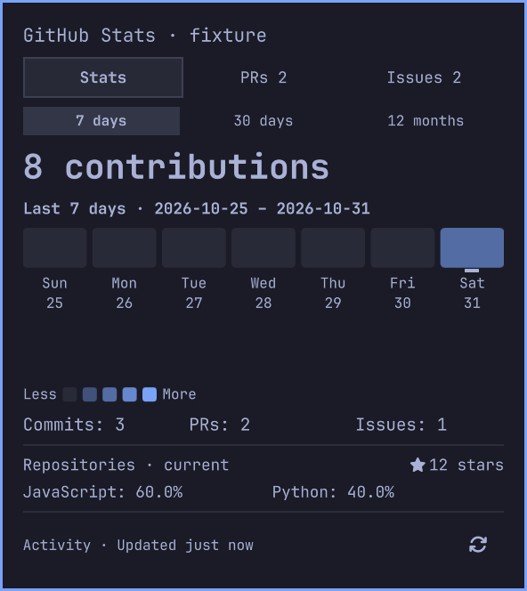

# Omarchy GitHub Stats

A native Omarchy bar plugin for personal GitHub contributions, pull requests, and issues. The bar shows a GitHub icon and today's contribution count; its popup has **Stats**, **PRs**, and **Issues** tabs.



The preview uses synthetic data, not a real GitHub account.

## Features

- **Contribution activity:** 7-day, 30-day, and 12-month views with contribution heatmaps and separate commit contribution, authored PR, and authored issue summaries.
- **Repository snapshots:** total stars and repository language shares across personally owned public and accessible private repositories, excluding forks.
- **Open work:** authored PRs, direct/team review requests, authored issues, and assigned issues, with full category totals, recent previews, and browser links.
- **Keyboard navigation:** Tab and arrow-key navigation, visible focus, and date/count tooltips for contribution heatmaps.
- **Refresh and recovery:** automatic and manual refresh, saved results during transient failures, and guidance for authentication, network, and rate-limit errors.
- **Native integration:** Omarchy theme colors, responsive layouts, and one host-managed service shared by monitor widgets.

## Requirements

- Omarchy's native Quickshell bar (`omarchy.bar`); verified against Omarchy **4.0.6-1** and Quickshell **0.3.2**. Other host versions and replacement bars are not verified.
- A working, authenticated GitHub CLI (`gh`) on the **running shell process's PATH**. Terminal aliases or interactive version-manager setup alone may not apply to that process.
- One effective account on `github.com`. Other Git hosts and in-widget account switching are outside v1.

Authenticate in a terminal, then check the effective account without printing tokens:

```sh
gh --version
gh auth login --hostname github.com
gh api --hostname github.com graphql -f 'query=query { viewer { login } }' --jq .data.viewer.login
```

Environment credentials supported by `gh` take precedence over its stored account. The plugin uses that effective identity and never starts an interactive login in the shell.

## Install and enable

```sh
omarchy plugin add https://github.com/jkvithanage/omarchy-github-stats --enable
```

The host clones and validates the plugin, then enables its widget and shared service. If installed without enablement, or to place it in the right bar section:

```sh
omarchy plugin enable omarchy-github-stats --section right
omarchy plugin list
```

Use the native `omarchy.bar`. Replacement bars can withhold the companion service from third-party widgets. Normal git-managed installations can be updated with `omarchy plugin update omarchy-github-stats`; review the offered changes. Do not use that updater on a development checkout with uncommitted work.

## Disable or remove

Disable the plugin while retaining its installation:

```sh
omarchy plugin disable omarchy-github-stats
```

Remove it, confirming the host's prompt:

```sh
omarchy plugin remove omarchy-github-stats
```

Removal unloads an enabled plugin. For a git-managed installation, it deletes the installed clone, including local edits; commit or copy any changes you want to keep first. For a development symlink, it unlinks the installation and leaves the checkout intact. GitHub CLI credentials remain managed by `gh`.

## Refresh and recovery

Refresh runs at startup, every fifteen minutes, after local midnight, and from the popup's **Refresh** button. Period switching uses cached data. The bar displays `—` for an unknown count and `0` for a successful zero. Today remains incomplete until the next local midnight.

The footer describes the visible section (Activity, PRs or Issues) with a relative update time; hover or focus it for exact local timestamps for every section. Repository freshness remains independent of Activity. Initial loading, refreshing saved work, and showing saved work after failure have distinct messages. Transient failures retain previous complete sections, marked stale with their original timestamps. An interrupted repository scan never publishes partial totals. Authentication loss or an observed account change clears prior-account data. Manual refresh respects rate-limit waits too.

For authentication errors, run `gh auth status --hostname github.com`, recover with `gh auth login --hostname github.com`, then press Refresh. If the widget reports missing/nonfunctional `gh` while terminal commands work, check the shell session's PATH and noninteractive version-manager setup. After correcting session startup environment, use `omarchy restart shell` to let the shell inherit it. Network, permission, timeout, rate-limit, and incomplete-response states have separate guidance in the popup; failures are never shown as zero activity.

Authentication guidance includes **Copy login command**, with visible and accessible confirmation; it copies only the fixed login command and does not start a terminal or login flow. Rate-limit guidance shows a live remaining wait and exact local retry time; Refresh stays disabled until that deadline. Completed empty work categories identify authored PRs, review requests from other authors, authored issues or assignments from other authors. Those empty messages are hidden while refreshing or showing failed/stale results.

## Data and access

The plugin is read-only: it fetches GitHub data and opens browser links. Credentials remain managed by `gh`; the plugin neither extracts nor stores tokens. Account responses stay in memory and are not logged or persisted by the plugin. The widget requests no additional permissions or separate credential service.

Contribution counts follow GitHub's eligibility and visibility rules. Accessible private activity and repository/work coverage depend on the effective credentials and GitHub's rules; the widget does not promise private-data completeness. Authored activity summaries include eligible creations that have since closed or merged. Open-work previews are independent of the selected period, and View all delegates full-list browsing to GitHub.

GitHub requires the optional `read:user` scope for private/internal contribution details, even with `repo` access. Without it, the heatmap can include private activity while commit, PR, and issue summaries omit it. When GitHub reports restricted contributions, Stats shows their selected-period count and marks the category counts with `+` as lower bounds. To authorize accessible private details, run `gh auth refresh --hostname github.com --scopes read:user`, complete GitHub's authorization, then refresh the widget. Activity your credentials cannot access can remain restricted.

## Verification and development

### Local development

From the root of your local checkout, validate it and symlink it into the user plugin directory:

```sh
omarchy plugin validate . &&
  mkdir -p "$HOME/.config/omarchy/plugins" &&
  ln -sT "$(pwd -P)" "$HOME/.config/omarchy/plugins/omarchy-github-stats"
```

The destination must be unused; `ln -sT` refuses to replace an existing installation or create a nested link inside it. If you already installed the plugin, follow [Disable or remove](#disable-or-remove) first, preserving any local edits before removing a git-managed clone.

After the symlink succeeds, rescan and enable the plugin:

```sh
omarchy shell shell rescanPlugins &&
  omarchy plugin enable omarchy-github-stats --section right
```

Edit files in your checkout to develop against the running shell. Saved plugin code normally hot-reloads; to explicitly reload it, restart the shell:

```sh
omarchy restart shell
```

To stop using the development copy, use `omarchy plugin remove omarchy-github-stats`; it removes the symlink and leaves your checkout intact.

### Checks

```sh
make check
make smoke
```

`make check` runs service fixtures, Qt model/heatmap keyboard tests, QML lint, and the installed manifest validator. Development checks require Node.js, Python 3, Make, and Qt 6 tooling; the installed plugin only requires Omarchy/Quickshell and `gh`. Tool paths default to `/usr/lib/qt6/bin` and `/usr/share/omarchy`; override `QT_BIN` or `OMARCHY_PATH` for a different installation. Offscreen keyboard tests substitute the host theme boundary; native smoke uses installed Omarchy components.

`make smoke` requires a Hyprland session. It briefly opens an isolated test bar/popup with two consumers and fixture `gh` responses, and leaves the installed bar configuration unchanged. Six modes cover successful loading/manual refresh, stale refresh, authentication, network, rate limits, and a real thirty-second process timeout. Fixtures contain no account data and make no network calls. See [verification details and manual checks](docs/verification.md).

## Project documentation

- [Specification](SPEC.md): agreed behavior and acceptance criteria.
- [Glossary](GLOSSARY.md): domain definitions.
- [Architecture decision](docs/adr/0001-native-omarchy-and-gh.md): native QML/Quickshell and GitHub CLI.
- [Marketplace readiness](docs/marketplace.md): release evidence, publication gates, and submission draft.

## License

This project is available under the [MIT License](LICENSE).
